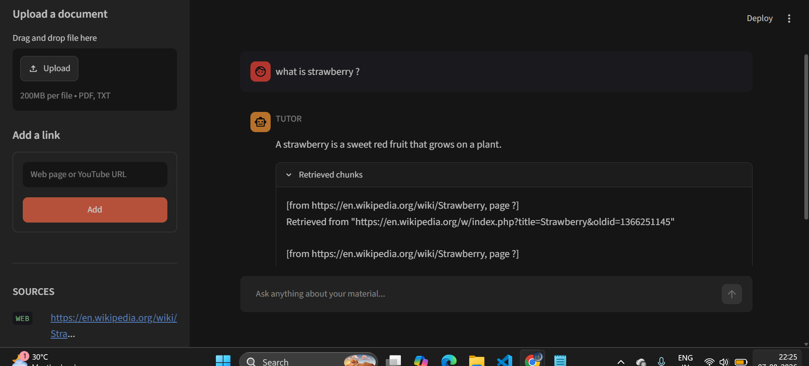
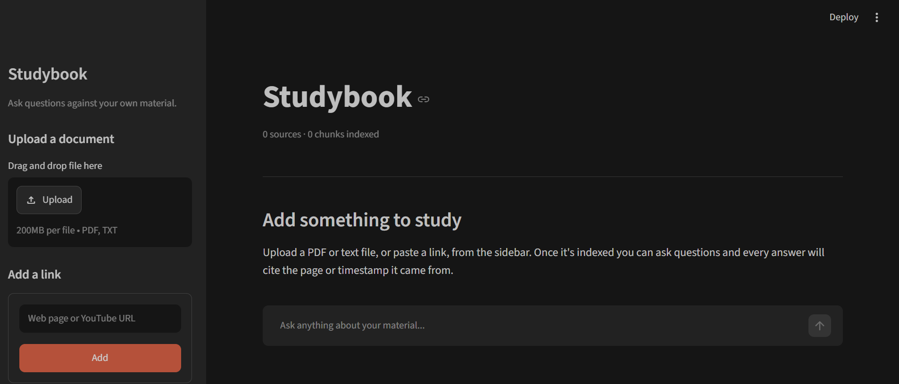

# Studybook — AI Research & Learning Companion

**Live demo:** https://studybook-ai.streamlit.app  
*(Free hosting: if nobody has opened it for 12 hours it sleeps — click "Yes, get this app back up!" and give it about a minute.)*

Ask questions against your own material. Upload PDFs, notes, web articles, or YouTube transcripts, then talk to them: get beginner-friendly explanations, generated quizzes, or cited factual answers — grounded in *your* documents, not the model's memory, and remembered across sessions.

Built as a portfolio project to cover the GenAI stack end to end: RAG, multi-agent orchestration with LangGraph, persistent conversation memory, a FastAPI backend, and a Streamlit frontend.

<!-- SCREENSHOT 1: loaded conversation, dark theme, TUTOR answer with Retrieved chunks expanded -->


---

## What it does

You add sources from the sidebar — drag-and-drop a PDF or TXT, or paste a web page / YouTube URL. Each source is loaded, chunked, embedded, and indexed into a persistent vector store. Then you ask questions in the chat, and an intent router sends each one to the right specialist:

- **TUTOR** — beginner-friendly explanation, analogy first, plain prose
- **QUIZ** — multiple-choice questions generated from retrieved material
- **RESEARCH** — factual answers with explicit citations (`[from source, page N]`)

Every answer carries an uppercase label showing which specialist produced it, and a collapsible **Retrieved chunks** panel showing exactly what the agent read before answering — the actual tool output from that turn, not a re-run of retrieval.

Conversations are remembered per user across sessions and across server restarts.

<!-- SCREENSHOT 2: empty state, dark theme -->


---

## Architecture

Two separate processes, talking only over HTTP:

```
Browser
  └── Streamlit UI (:8501)          ui/app.py — imports nothing from the project
        └── HTTP / JSON
              └── FastAPI (:8000)   api/main.py — /upload, /ask, /profile/{user_id}
                    └── LangGraph   router → { tutor | quiz | research } → (tools → back)* → END
                          ├── Chroma          persistent vector store (retrieval seam: rag/retrieve.py)
                          ├── SqliteSaver     conversation checkpoints, keyed by thread_id = user_id
                          └── Groq LLM        openai/gpt-oss-20b
```

Dependency direction is strictly one-way: `ui → api → agents → rag → ingestion → config`. The UI imports only `requests` and `streamlit` — it could be replaced with React tomorrow and no AI code would change.

**Two mechanisms in one graph.** The intent router is a *workflow*: a human-written rule reads the classified intent and picks the lane. The tool loop is an *agent*: the model itself decides whether to call `search_documents` (and writes its own search query — "explain chunking like I'm a beginner" becomes `query="chunking definition"`). A hard `step_count` ceiling, reset per turn by the router, guarantees the loop terminates regardless of what the model does.

**Three separate stores, three separate jobs.**

| Store | Holds | Keyed by |
|---|---|---|
| Chroma (`data/chroma_db`) | document chunks + embeddings | — (shared pool) |
| SQLite (`data/checkpoints.sqlite`) | full conversation state snapshots | `thread_id` = `user_id` |
| `data/profiles.json` | per-user topic progress | `user_id` |

Conversation memory and user memory are deliberately separate: the checkpointer answers "what did we just say?", the profile store answers "what does this person know?". The profile store is scaffolded and tested but not yet wired to a grader — automatic topic-tagging is deferred (see roadmap).

---

## Stack

Python · LangGraph · LangChain · Chroma · sentence-transformers model `paraphrase-multilingual-MiniLM-L12-v2` (run via fastembed/ONNX) · Groq (`openai/gpt-oss-20b`) · FastAPI + uvicorn · Streamlit

---

## Running it locally

```bash
git clone <this repo>
cd ai-learning-companion
python -m venv venv && venv\Scripts\activate        # Windows
pip install -r requirements.txt
copy .env.example .env                               # add your GROQ_API_KEY
```

Two terminals:

```bash
# 1 — the API
uvicorn api.main:api --reload

# 2 — the UI
streamlit run ui/app.py
```

Or, one command that starts both (this is what the live deployment runs):

```bash
streamlit run streamlit_app.py
```

Open http://localhost:8501, add a source from the sidebar, and ask a question. The API also exposes interactive docs at http://localhost:8000/docs.

---


## Project structure

```
config.py            env, constants, shared llm + embeddings
state.py             LearningState TypedDict
ingestion/           pdf / web / youtube / notes loaders + dispatcher
rag/                 chunking, vector store, retrieval seam, RAG chain
agents/              tools, nodes (router + 3 specialists), graph, profile store
api/main.py          FastAPI: /upload, /ask, /profile/{user_id}
ui/app.py            Streamlit frontend (HTTP only)
tests/               run as: python -m tests.<name>
```
